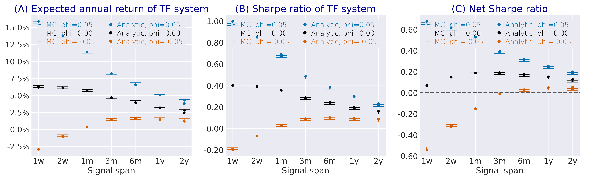
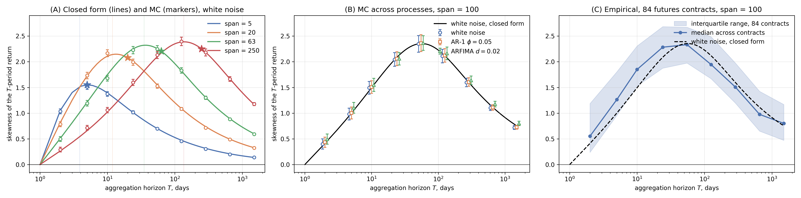
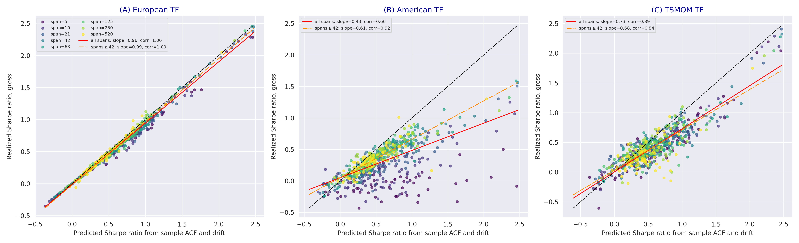
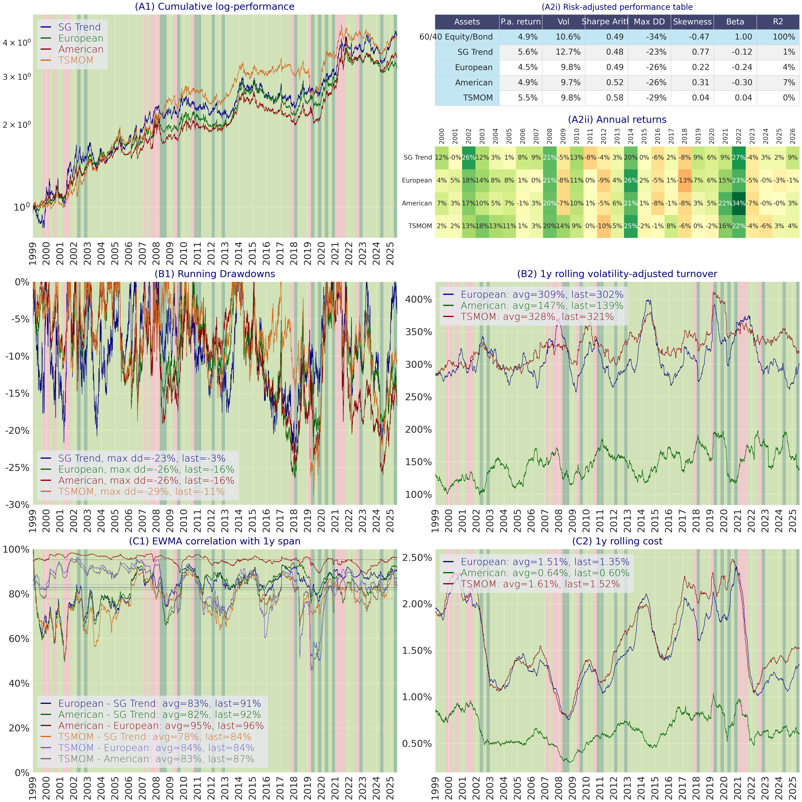

# trendfollowing

**Closed-form trend-following analytics, reference system implementations, and reproducible
futures evidence in Python for quantitative researchers and practitioners**

It is a research and replication library, not a broker integration or general-purpose execution
engine; portfolio analytics and reporting are delegated to `qis`.

**Install:** `pip install trendfollowing` · **Import:** `trendfollowing` · **Status:** Beta

[](https://pypi.org/project/trendfollowing/)
[](https://pypi.org/project/trendfollowing/)
[](https://github.com/ArturSepp/TrendFollowingSystems/actions/workflows/ci.yml)
[](https://trendfollowingsystems.readthedocs.io/en/latest/)
[](LICENSE)
[](https://pepy.tech/project/trendfollowing)
[](https://pepy.tech/project/trendfollowing)

**Paper:** Sepp, A. and Lucic, V., *The Science and Practice of Trend-Following
Systems*. **Read and download the paper on SSRN:**
[ssrn.com/abstract=3167787](https://ssrn.com/abstract=3167787)
(doi:[10.2139/ssrn.3167787](https://doi.org/10.2139/ssrn.3167787)); also available as
[arXiv:2607.19497](https://arxiv.org/abs/2607.19497).
See [Statement of need](#statement-of-need) for what the package implements from it and
[Citation](#citation) for the BibTeX entry. The replication material for every figure and table
is in [`papers/tf_systems/`](papers/tf_systems/).

**Documentation:** the [trendfollowing handbook](https://trendfollowingsystems.readthedocs.io/en/latest/)
develops every result below chapter by chapter (filters, normalisation, processes, the P&L
identity, the closed-form Sharpe ratio, costs, skewness and the three systems), with worked
examples that the test suite executes and an API reference grouped by chapter.

---

## Why trendfollowing

Two sample moments of a contract's volatility-normalised returns — its autocorrelation function
and its drift — carry nearly all the information a trend-following backtest on that contract
produces. `trendfollowing` makes that statement operational: the analytics layer is pure
numpy/scipy, every formula is a function you can read, and the backtest layer builds on
[`qis`](https://github.com/ArturSepp/QuantInvestStrats).

### Key differentiators

The package is useful when three things matter:

- You want to **select the filter span analytically** rather than by grid
  search: the AR-1 break-even cost is nearly span-invariant
  ($c^{*}_{\infty} = \sqrt{\pi/2a} \phi/(1-\phi)$, 37–41bp at $\phi = 0.05$),
  while ARFIMA long memory creates an interior cost-optimal span — two regimes
  the closed forms separate cleanly.
- You want to **predict a contract's trend-following Sharpe ratio from its
  autocorrelation function and drift** before running a backtest, and to
  attribute realised performance to trend, mean reversion, and drift.
- You want **three reference system implementations** — continuous EWMA-filter
  weights, binary crossover positions with ATR stops, and sign-based time
  series momentum — that run out of the box on the packaged dataset, net of
  volume-based costs, with portfolio volatility targeting.

### When to use it — and when not

Use `trendfollowing` to choose a filter span, a contract or a cost budget from the closed forms,
to attribute a realised trend-following Sharpe ratio to autocorrelation and drift, and to run or
replicate the European, American and TSMOM systems on the packaged 84-contract futures universe.

It is a research and replication library, not a broker integration or general-purpose execution
engine; portfolio analytics and reporting are delegated to `qis`, option-chain workflows belong to
`option-chain-analytics` and pricing under stochastic volatility to `stochvolmodels`.

## Installation

```bash
pip install trendfollowing
```

Python >= 3.10 and `qis` >= 5.0.9. The analytical layer and the Monte Carlo
verification run without any data. Wheels and source checkouts include the
empirical dataset (84 futures contracts, benchmarks, volume-based costs;
1959–2026). For an editable checkout with the test and lint tools, see [Testing](#testing).

## Table of contents

1. [Why trendfollowing](#why-trendfollowing)
2. [Installation](#installation)
3. [Statement of need](#statement-of-need)
4. [Overview](#overview)
5. [Five-minute quickstart](#five-minute-quickstart)
6. [Examples](#examples)
7. [Testing](#testing)
8. [Changelog](#changelog)
9. [Feedback & contributing](#feedback-contributing)
10. [Citation](#citation)
11. [Ecosystem](#ecosystem)
12. [License](#license)
13. [Disclaimer](#disclaimer)

## Statement of need

`trendfollowing` implements the paper's central result: an exact decomposition
of the European trend-following system's P&L into an autocorrelation channel
and a squared-drift channel,

```math
\bar F_{1y} = h \sum_{m=1}^{\infty} \nu^{m}\rho(m)
+ \frac{l \sigma_{\mathrm{target}}}{\sqrt{a}} \mu^{2},
\qquad h = l \sigma_{\mathrm{target}} \sqrt{a} \frac{1-\nu}{\nu}
```

where $\rho(m)$ is the autocorrelation function of volatility-normalised
returns, $\mu$ their annualised drift, and $\nu$ the filter smoothing parameter
of the span. The annualised Sharpe ratio follows in closed form for any causal
linear process, with the excess kurtosis of the innovations entering through a
single loading. On 84 liquid futures contracts, the closed form applied to
sample moments reproduces the realised Sharpe ratios of the European system
with a pooled correlation of 0.99 and a regression slope of 0.96. The paper states the results;
this package is what produced them.

| Paper | Implemented analytics | Where |
|---|---|---|
| Sepp, A. and Lucic, V. (2026), *The Science and Practice of Trend-Following Systems*, [SSRN 3167787](https://ssrn.com/abstract=3167787) / [arXiv:2607.19497](https://arxiv.org/abs/2607.19497) | The P&L decomposition, the closed-form Sharpe ratio under causal linear processes (white noise, AR(1), ARFIMA) with the kurtosis loading, the break-even cost and net Sharpe ratio, the skewness of aggregated returns, the European, American and TSMOM systems, the 84-contract futures universe with volume-based costs, and the per-contract Sharpe prediction from sample moments | `trendfollowing.analytics`, `trendfollowing.systems`, `trendfollowing.universe`, [`papers/tf_systems/`](papers/tf_systems/), [handbook paper chapter](docs/paper.md) |

## Overview

```
src/
    trendfollowing/                     the installable library
        analytics/                          closed-form results of the paper
        systems/                            european.py, american.py, tsmom.py
        processes/                          simulation of return-generating processes
            run_local/                      process development runners; not distributed
        run_local/                          package development runners; not distributed
        resources/futures/                  84 futures series (1959-2026), benchmarks,
                                           volume-based costs, and metadata
        universe.py                         futures universe data layer
        backtests.py                        portfolio-level backtests of the three systems (qis)
resources/
    papers/                            ignored legacy caches; new output stays external
examples/                           self-contained usage cases; kept at repository root
papers/
    tf_systems/                         'The Science and Practice of Trend-Following Systems'
        paper/                              approved LaTeX source, SIAM class and twelve figures
        replication/                        generators, verification scripts, data/reference/, tests/
tests/                              pytest suite
```

**The three systems.**
**European** ([`systems/european.py`](src/trendfollowing/systems/european.py)): continuous
weights from a variance-preserving EWMA filter, single or long-short, applied to
volatility-normalised returns, with volatility-targeted position sizing. The system of the
closed forms. **American** ([`systems/american.py`](src/trendfollowing/systems/american.py)):
binary positions from the crossover of two price EWMA filters with an ATR entry buffer and ATR
trailing stop-losses, in the tradition of the turtle systems; position size is fixed at trade
inception. **TSMOM** ([`systems/tsmom.py`](src/trendfollowing/systems/tsmom.py)): the normalised
sum of signs of volatility-normalised period returns, generalising Moskowitz–Ooi–Pedersen time
series momentum to a period length L and lookback of M periods. At matched lookbacks the three
systems correlate at 80% on average with the SG Trend Index and deliver statistically
indistinguishable Sharpe ratios by the Ledoit–Wolf test: 0.47, 0.50, and 0.55 against 0.47 for
the SG Trend Index, on monthly returns net of costs and 2/20 fees. The European closed form
therefore ranks the performance of all three designs.

**Data.** The dataset installed under `trendfollowing/resources/futures` contains the daily
prices and USD returns of the 84 futures contracts used in the paper (July 1959 to July 2026),
the benchmark series, the volume-based cost schedule, and the instrument metadata. The universe
covers the most liquid contracts across global equity, bond, short-rate, currency, and commodity
markets. The continuous series are constructed so that their relative returns carry no
roll-related jumps and equal the excess returns of the held contract.
`trendfollowing.universe.load_data()` resolves these files through package resources; set
`TF_RESOURCE_PATH` to override them with an external folder.

**Sharpe convention.** All Sharpe ratios of the theory, the attribution, and the report exhibits
are annualised arithmetic means over annualised volatility of periodic simple excess returns,
$SR = \sqrt{a}\cdot\text{mean}/\text{std}$ — the convention of equation (5.1) of the paper,
computed by the shared estimator `trendfollowing.compute_realized_sharpe`. The
regime-conditional Sharpe ratios route through the qis `SharpeConvention.ARITHMETIC` switch at
the manuscript's one-sigma 16/84 quantiles, where the bear, normal, and bull contributions sum
to the total Sharpe exactly. See `qis/docs/sharpe_conventions.md` for the decision record.

### Methods

| Result | Formula | Implementation | Chapter |
|---|---|---|---|
| P&L decomposition of the European system | $\bar F_{1y} = h \sum_m \nu^m \rho(m) + \frac{l\sigma_{\mathrm{target}}}{\sqrt a}\mu^2$ | `expected_return.expected_pnl_*` | [P&L decomposition](docs/pnl_decomposition.md) |
| Closed-form annualised Sharpe ratio under a causal linear process | $SR = \dfrac{\sqrt{a} A_{\nu} + \mu^{2}/\sqrt{a}}{\sqrt{B_{\nu} + A_{\nu}^{2} + \kappa K_{\nu} + (\mu^{2}/a)(1 + B_{\nu} + 2A_{\nu})}}$ with the kurtosis loading $K_\nu$ | `sharpe.compute_annualised_sharpe(rho, long_span, short_span, sr_underlying)`, `sharpe.sharpe_ar1`, `sharpe.compute_kurtosis_loading`, `sharpe.compute_signal_moments` | [closed-form Sharpe ratio](docs/sharpe_ratio_closed_form.md), [Sharpe under processes](docs/sharpe_under_processes.md) |
| Population autocorrelation functions | white noise, AR(1), ARFIMA(0,d,0), ARFIMA(1,d,0) (Sowell 1992); the ARFIMA autocorrelation generating function is $F(d, 1, 1-d; \nu)$ | `autocorrelation.population_acf(n_lags, phi, d)` | [return processes](docs/return_processes.md) |
| Net Sharpe ratio under costs and the break-even cost | leading-order net Sharpe from an independence-based signal-turnover proxy; $c^{*}_{\infty} = \sqrt{\pi/2a}\,\phi/(1-\phi)$ for AR-1 | `expected_return.expected_turnover` | [turnover and net Sharpe](docs/turnover_and_net_sharpe.md) |
| Skewness of aggregated returns under white noise | $\varsigma(T) = \dfrac{6\nu \left( T(1-\nu^{2}) - 1 + \nu^{2T} \right)}{(1-\nu^{2})^{3/2} T^{3/2}}$ — zero at one day, positive beyond, peaking near half the span | `analytics.skewness.skewness_white_noise(horizon, span)` | [aggregated skewness](docs/aggregated_skewness.md) |
| Realised Sharpe estimator | $\sqrt{a}\,\hat E[f_t]/\sqrt{\widehat{\mathrm{Var}}[f_t]}$, equal to `qis.compute_sharpe_arithmetic` (guarded in the tests) | `sharpe.compute_realized_sharpe(returns, af, ddof)` | [Sharpe inference](docs/sharpe_inference.md) |

### Analytics at a glance

| Area | What the package computes |
|---|---|
| Closed-form analytics (`trendfollowing.analytics`) | Expected P&L and turnover per process, gross and net Sharpe ratios across spans, kurtosis loadings, signal moments, population ACFs, aggregated skewness |
| Systems (`trendfollowing.systems`) | `run_european_tf_system` and the American and TSMOM counterparts with volatility normalisation, portfolio volatility targeting and volume-based costs |
| Processes (`trendfollowing.processes`) | Simulation of white-noise, AR(1), ARFIMA and GARCH return-generating processes for Monte Carlo verification of the closed forms |
| Universe and backtests | `load_data()` for the packaged 84-contract universe, benchmarks and costs; `backtests.py` for portfolio-level backtests of the three systems through `qis` |
| Replication | `papers/tf_systems/replication/` generators, verification scripts and nine frozen reference caches for every figure and table of the paper |

## Five-minute quickstart

The authoritative first-success script is repository-only, so run it from a cloned checkout:
[`examples/quickstart.py`](https://github.com/ArturSepp/TrendFollowingSystems/blob/main/examples/quickstart.py).
It uses only the installed top-level API to compute deterministic AR(1) and ARFIMA closed forms:

```console
python examples/quickstart.py
```

It prints the installed version, AR(1) Sharpe `0.200195`, ARFIMA(0,d,0) Sharpe `0.288820`, and
the 260-day annualization, zero-drift, and single-EWMA conventions. It runs without network or
data access, writes no files, and points to `PHI`, `D`, and `LONG_SPAN` as the first parameters
to change. The [documentation quickstart](https://trendfollowingsystems.readthedocs.io/en/latest/quickstart.html)
includes the same file mechanically.

A portfolio backtest of the paper's LS(250,20) filter on the packaged universe:

```python
from trendfollowing.universe import load_data
from trendfollowing.systems.european import run_european_tf_system

prices, volume_costs, benchmark_prices, descriptive_df, group_order = load_data()
outputs = run_european_tf_system(prices=prices,
                                 long_span=250,
                                 short_span=20,
                                 vol_span=33,                  # volatility estimator span, days
                                 portfolio_covar_span=63,      # portfolio-level volatility targeting
                                 portfolio_target_vol=0.15,
                                 volume_costs=volume_costs,
                                 warmup_period=250)
nav = outputs.portfolio_pnl_net                                # compounded nav, net of costs
```

Net of volume-based costs and gross of fees, this configuration delivers a
Sharpe ratio of 1.10 at a 15.2% realised volatility over 1960–2026
([`examples/backtest_european_system.py`](examples/backtest_european_system.py)).

## Examples

### Highlighted examples

**Closed forms against Monte Carlo.** Figure 6.3 of the paper: the expected annual return, the
gross Sharpe ratio, and the net Sharpe ratio of the European system under the ARFIMA process
with long memory $d = 0.02$ and AR-1 feature $\phi \in \{-0.05, 0, 0.05\}$, with the analytic
values as lines and the Monte Carlo estimates as markers. Analytic and Monte Carlo values agree
at every span. The net Sharpe ratio in panel (C) attains an interior cost-optimal span, which
long memory creates and the AR-1 process does not, because there the cost-optimal span diverges
at the break-even cost.



**Skewness of aggregated returns.** Figure 7.5 of the paper: panel (A) is the closed form across
filter spans with Monte Carlo markers, panel (B) is Monte Carlo under white noise, AR(1), and
ARFIMA at the span of 100 days, and panel (C) is the empirical profile across the 84 futures
contracts, whose median attains 2.33 at the horizon of 55 days against the closed-form 2.35 and
whose interquartile range stays positive at every horizon. The right tail of trend-following
returns is structural: it requires no forecasting skill, because it holds exactly where the
expected return is zero.



**Predicted versus realised Sharpe ratios.** Figure 7.3 of the paper: the Sharpe ratio of the
European system predicted from each contract's sample autocorrelation function and drift,
against the realised backtest Sharpe ratio, across 84 futures contracts and the paper's span
grid. The pooled correlation is 0.99 and the regression slope 0.96 for the European system, 0.89
and 0.73 for TSMOM, and 0.92 and 0.61 for the American system at spans above one month. At
realistic futures costs of 40–60bp per unit of volatility-normalised turnover, a short-memory
AR-1 alpha at $\phi = 0.05$ sits below its 37–41bp break-even at every span, while long-memory
alpha survives at the one-to-three-month cost-optimal spans. The per-contract exercise takes
three lines ([`examples/predict_sharpe_from_acf.py`](examples/predict_sharpe_from_acf.py)): ES1
predicts 0.227 against a realised 0.206, and Corn predicts 0.625 against 0.620.



**The three systems against the SG Trend Index.** Figure 7.2 of the paper: the European,
American, and TSMOM systems net of volume-based costs against the SG Trend Index, with the
cumulative performance, the running drawdown, and the one-year EWMA correlations.



### Runnable examples

Self-contained usage cases in [`examples/`](examples/), each runnable directly:

- [`quickstart.py`](examples/quickstart.py) — deterministic AR(1) and ARFIMA closed forms from
  the installed top-level API; no data.
- [`analytic_sharpe_vs_span.py`](examples/analytic_sharpe_vs_span.py) — the
  closed-form gross and net Sharpe ratios across spans: the AR-1 knife edge
  (the cost decides the sign at every span) and the ARFIMA interior optimum.
  Runs without data.
- [`backtest_european_system.py`](examples/backtest_european_system.py) — the
  LS(250,20) portfolio backtest on the packaged 84-contract universe with
  volume-based costs and portfolio volatility targeting.
- [`predict_sharpe_from_acf.py`](examples/predict_sharpe_from_acf.py) — the
  attribution exercise in miniature: predict the per-contract Sharpe ratio
  from the sample autocorrelation function and drift, and compare with the
  realised backtest on the same sample.

### From method to implementation

One entry point reproduces every figure of the paper, driven by the `PaperFigure` enum:

```bash
python -m papers.tf_systems.replication.reproduce_all_figures
```

Nine frozen caches in `papers/tf_systems/replication/data/reference/` support
the three process figures and two attribution figures. Render those with
`python -m papers.tf_systems.replication.cached_figures`; full regeneration above
also runs expensive simulations and data-dependent stages. New output goes to
the external paper runtime. Table 6.1 needs separate generated simulation parts.
See [`papers/tf_systems/README.md`](papers/tf_systems/README.md) for commands,
the figure map and verification catalogue. The approved manuscript source and
figures are tracked; the reading PDF remains local.

`papers/tf_systems/replication/` also carries the verification scripts behind the
manuscript's claims: the boundary term of the sample-path identity, the
Appendix C asymptotics, the GARCH pipeline and ARFIMA truncation checks, and a
Monte Carlo regression test of the long-short normalisation and the turnover
closed form:

```bash
cd papers/tf_systems/replication && PYTHONPATH=../../.. python verify_ls_normalization.py
```

## Testing

```bash
git clone https://github.com/ArturSepp/TrendFollowingSystems.git
cd TrendFollowingSystems
uv sync --locked --group test
uv run --no-sync pytest
uv run --locked --only-group lint ruff check src/trendfollowing/
```

The suite executes the handbook's worked examples and guards the realised-Sharpe estimator
against `qis.compute_sharpe_arithmetic`; the analytical layer and the Monte Carlo verification
need no data.

## Changelog

Release history is maintained in [CHANGELOG.md](CHANGELOG.md).

## Feedback & contributing <a name="feedback-contributing"></a>

- **Bug or replication mismatch:** [open the bug-report form](https://github.com/ArturSepp/TrendFollowingSystems/issues/new?template=bug_report.yml)
  with the package/Python versions, platform, parameters, minimal reproducer, and expected and
  actual result.
- **Feature or methodology:** [open the feature-request form](https://github.com/ArturSepp/TrendFollowingSystems/issues/new?template=feature_request.yml)
  with the replication result or parameterisation that is unclear, your current workaround, and
  the smallest useful API or documentation change.
- **Question:** search or open an [issue](https://github.com/ArturSepp/TrendFollowingSystems/issues)
  and name the paper section, system, or convention involved.
- **Contribution:** read [`CONTRIBUTING.md`](CONTRIBUTING.md), then browse
  [`good first issue`](https://github.com/ArturSepp/TrendFollowingSystems/issues?q=is%3Aissue%20state%3Aopen%20label%3A%22good%20first%20issue%22)
  or [`help wanted`](https://github.com/ArturSepp/TrendFollowingSystems/issues?q=is%3Aissue%20state%3Aopen%20label%3A%22help%20wanted%22)
  work.

## Citation

If you use `trendfollowing` in academic work, please cite the software and the paper (see also
[`CITATION.cff`](CITATION.cff)). The paper states the results; this package is what produced
them, so a replication should also cite the version it ran:

```bibtex
@software{sepp2026trendfollowing,
  author  = {Sepp, Artur and Lucic, Vladimir},
  title   = {trendfollowing},
  year    = {2026},
  version = {1.3.1.post1},
  url     = {https://github.com/ArturSepp/TrendFollowingSystems}
}
```

```bibtex
@article{SeppLucic2026trendfollowing,
  author        = {Sepp, Artur and Lucic, Vladimir},
  title         = {The Science and Practice of Trend-Following Systems},
  year          = {2026},
  eprint        = {2607.19497},
  archivePrefix = {arXiv},
  primaryClass  = {q-fin.ST},
  note          = {SSRN: \url{https://ssrn.com/abstract=3167787}},
  doi           = {10.2139/ssrn.3167787}
}
```

## Ecosystem

This package is part of an open-source Python stack for quantitative finance. The
[ArturSepp profile](https://github.com/ArturSepp) is the canonical catalogue:

| Package | Purpose |
|---|---|
| [`qis`](https://github.com/ArturSepp/QuantInvestStrats) | Performance analytics, backtesting, and factsheet reporting |
| [`optimalportfolios`](https://github.com/ArturSepp/OptimalPortfolios) | Portfolio construction and rolling backtesting |
| [`factorlasso`](https://github.com/ArturSepp/factorlasso) | Sparse factor-model estimation |
| [`bbg-fetch`](https://github.com/ArturSepp/BloombergFetch) | Bloomberg data in pandas DataFrames |
| [`option-chain-analytics`](https://github.com/ArturSepp/OptionChainAnalytics) | Point-in-time option-chain data and queries |
| [`vanilla-option-pricers`](https://github.com/ArturSepp/VanillaOptionPricers) | Numba-vectorised BSM and Bachelier pricing |
| [`stochvolmodels`](https://github.com/ArturSepp/StochVolModels) | Stochastic-volatility pricing and calibration |
| [`trendfollowing`](https://github.com/ArturSepp/TrendFollowingSystems) *(this package)* | Closed-form trend-following analytics |
| [`privateassets`](https://github.com/ArturSepp/privateassets) | Multi-factor PME for private assets |
| [`goal-based-allocation`](https://github.com/ArturSepp/GoalBasedAllocation) | Goal-based allocation under regime-switching jump-diffusions |

`trendfollowing` depends on `qis` for portfolio analytics, backtesting, and reporting. The
closed-form trend analytics and paper replication remain this package's distinct job.

## License

MIT from version 1.3.1.post1 — see [`LICENSE`](LICENSE). Earlier published releases
retain their original GPL-3.0-or-later terms. The transition changes licensing and
attribution only; numerical implementations, public APIs and bundled data are unchanged.

Retained ARFIMA and QIS attributions and full upstream terms are in [`NOTICE`](NOTICE).
The software licence does not grant rights to third-party market data, vendor services or
manuscripts; their applicable permissions remain separate. Dependencies retain their own
licences, so MIT describes this package rather than every component in an installed environment.

## Disclaimer

`trendfollowing` is distributed FREE & WITHOUT ANY WARRANTY under the MIT License. See
[LICENSE](LICENSE) in the release for details. Use the routes in
[Feedback & contributing](#feedback-contributing) for bugs, feature requests and
methodology questions.
